# Sound Atlas · 声音地图

> **THE WORLD HAS A SOUNDTRACK.**
> 用耳朵，重新认识这个世界。

A global map of environmental sound. Every point on the map is a **real field recording**,
stored on a public archive, played from there, and credited to the person who made it.

一张全球环境声音地图。地图上的每一个点都是一段**真实的田野录音**，存放于公开档案站、
从原站播放，并标注录制者与许可证。

[](https://iiiiiiiiiiiiiikk.github.io/sound-atlas/)
[](LICENSE)
[](#testing--测试)
[](#architecture--架构)

**Live demo → <https://iiiiiiiiiiiiiikk.github.io/sound-atlas/>**
**Author → <https://x.com/0xkillcoin>**

---

## Why this exists · 为什么做这个

Maps show you where a place is. They never show you what it *sounds* like. Meanwhile,
thousands of people have already uploaded careful field recordings — birds at dawn, rain on a
tin roof, a market at midday — and almost nobody can find them, because they live in archive
categories instead of on a map.

Sound Atlas is a thin, honest layer over that existing work: it puts real recordings on a map,
plays them from their original host, and makes the licence and the recordist visible every time.

地图只告诉你在哪儿，却从不告诉你那里听起来是什么样。与此同时，已经有人认真录下了成千上万段
声音——清晨的鸟、铁皮屋顶上的雨、正午的市场——但它们沉在档案分类里，几乎没人找得到。
Sound Atlas 只是一个诚实的小层：把已有的真实录音放回地图，从原始主机播放，并始终注明
许可证与录制者。

**It does not re-host audio. It does not invent locations. It does not generate sounds.**

---

## Screenshots · 界面截图

All images are captured from the production build by `npm run shots`, not mocked up.

| Home (dark) | Home (light) |
| --- | --- |
| 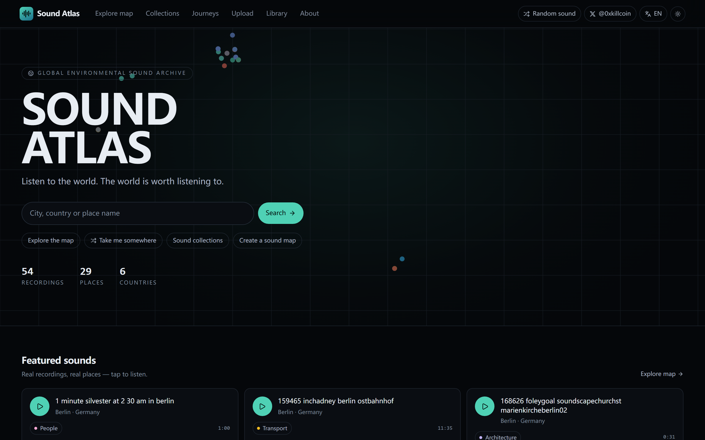 | 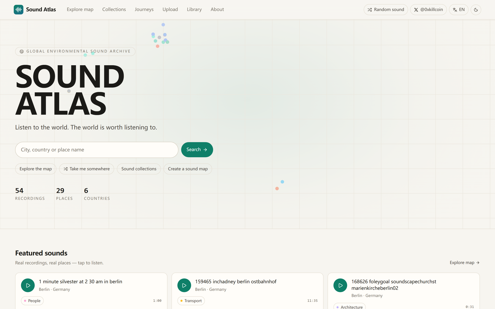 |

| Explore map | Sound detail |
| --- | --- |
| 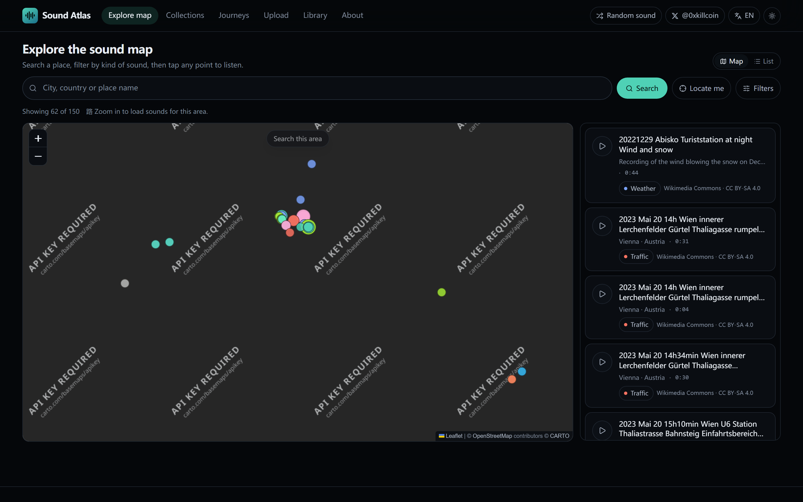 | 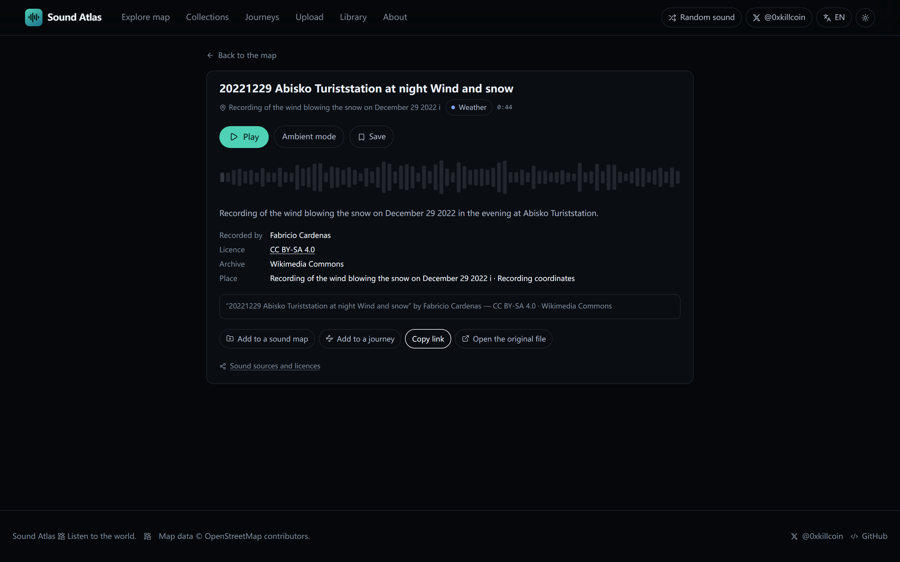 |

| Collections | Library |
| --- | --- |
| 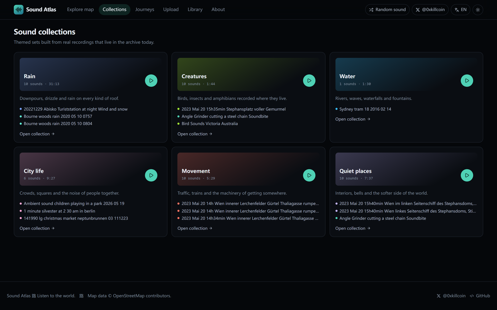 | 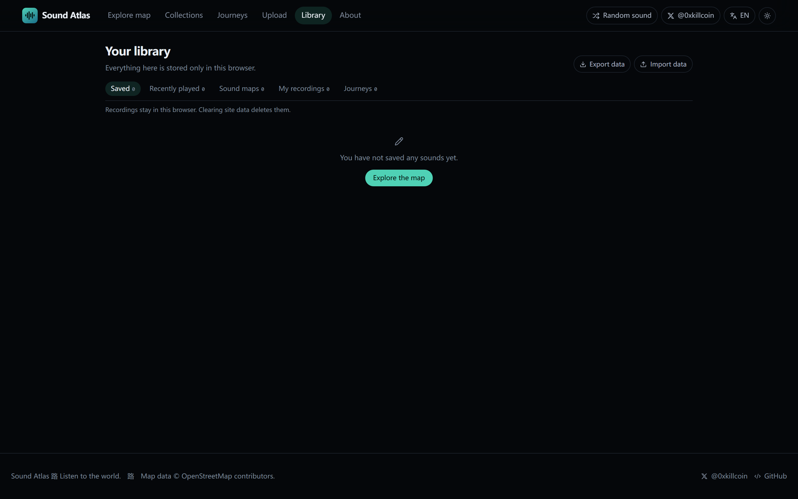 |

| Upload | About |
| --- | --- |
| 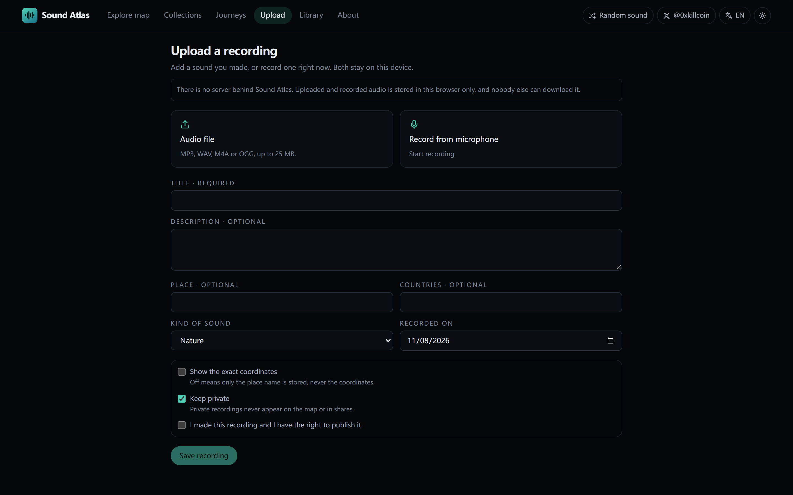 | 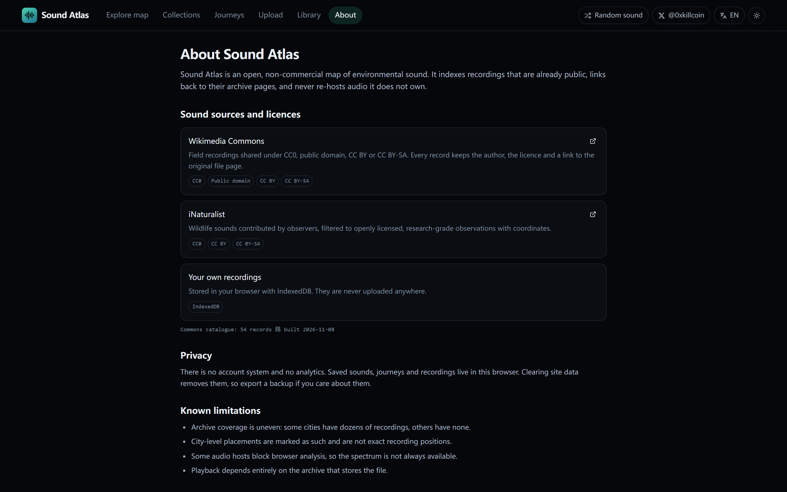 |

| Mobile home | Mobile explore | Mobile collections |
| --- | --- | --- |
| 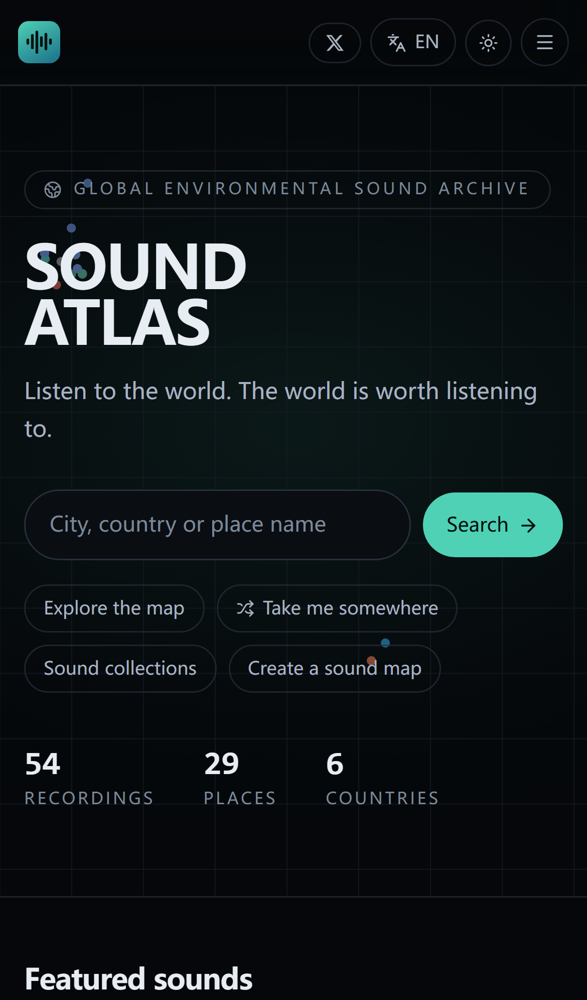 | 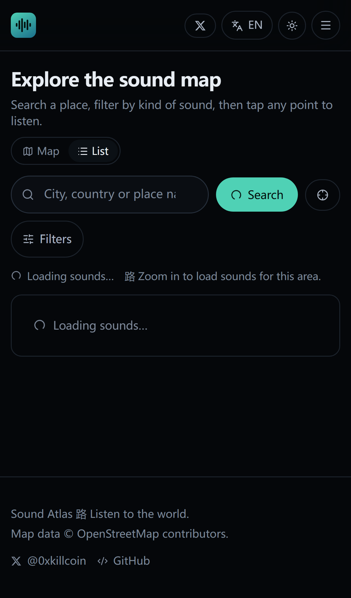 | 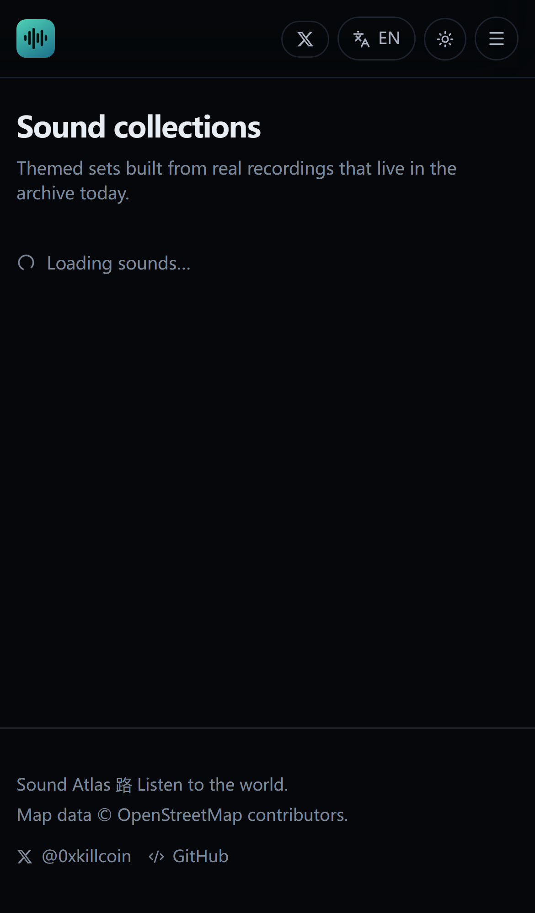 |

---

## What you can actually do · 实际能做什么

| Feature | English | 中文 |
| --- | --- | --- |
| Global sound map | Explore real recordings on an OpenStreetMap base, coloured and shaped by kind of sound, clustered by proximity | 在真实地图上浏览录音，按声音类型着色，按距离聚合 |
| Place search | Type a city or country, the map jumps there and loads only that window | 输入城市或国家，地图跳转并只加载该范围 |
| Search this area | Pan somewhere else and load that viewport | 拖动地图后加载当前视野 |
| Locate me | Browser geolocation, with an honest message when it is denied | 浏览器定位，被拒绝时给出明确提示 |
| Filters | Kind of sound, archive, minimum length, precise coordinates only | 声音类型、数据源、最短时长、仅精确坐标 |
| Playback | Real archived file, waveform, seek, volume, mute, speed, loop, next/previous | 播放原始档案文件、波形、拖动进度、音量、静音、倍速、循环、上/下一段 |
| Ambient mode | Full-screen listening: big place name, real spectrum, sleep timer, auto-advance | 沉浸模式：大字号地点、真实频谱、定时停止、自动续播 |
| Random sound | "Take me somewhere" — a seeded pick from playable sounds right now | 「带我去个地方」——从当前可播放的声音中随机抽取 |
| Collections | Six themed sets resolved live from the providers, never a hard-coded list | 六个专题，实时查询生成，绝不硬编码清单 |
| Personal sound maps | Group sounds into your own themed maps | 把声音组织成自己的主题地图 |
| Sound journeys | An ordered listening route through real places, with skipping and reordering | 按地点顺序聆听的路线，可跳过、可拖动排序 |
| Upload / record | Upload a file or record from the microphone (MediaRecorder), stored locally | 上传文件或直接用麦克风录制，保存在本机 |
| Library | Saved sounds, play history, maps, journeys, recordings, JSON export/import | 收藏、播放记录、地图、路线、录音、JSON 导出导入 |
| Sharing | Per-sound deep link, copyable, resolves after a hard reload | 每段声音的独立链接，刷新后仍可打开 |
| Bilingual | Complete English and 简体中文, browser-detected, switchable | 完整中英双语，按浏览器语言自动选择，可切换 |
| Themes | Dark and light, persisted | 深色与浅色主题，可记忆 |

Every interactive control on the site is wired to real behaviour. There are no disabled
placeholders, no fake counters, no "coming soon" buttons.

站点上每一个可交互控件都对应真实行为。没有占位按钮，没有虚假计数，没有「敬请期待」。

---

## Audio sources and licences · 声音来源与许可证

This is the part that matters most. **No audio is invented, generated, or re-hosted.**

### 1. Wikimedia Commons (`source: commons`)

The shipped catalogue is built by `scripts/fetch-commons-catalog.mjs`, which walks the
`Category:Audio files of <City>` families and a set of soundscape categories through the live
`action=query` API and keeps a file only if **all** of these hold:

- the MIME type is audio and the file is under 24 MB (so it can stream quickly);
- the declared licence is **CC0, Public Domain, CC BY, or CC BY-SA** — everything else is dropped;
- the text does not indicate speech, music, news, narration, or synthesised noise;
- the text *does* claim to be environmental sound;
- the file has real place evidence — either its own EXIF GPS coordinates, or a
  `Audio files of <KnownCity>` category. Files with no location at all are discarded, never
  placed at a random point.

Current build: **54 records**, each with author, licence and the original file page. Coordinates
carry a `precision` flag:

- `exact` — the recording's own GPS coordinates;
- `city` — placed at its city centre, and labelled as such in the UI.

Playback streams the Commons MP3 transcode (`upload.wikimedia.org`), which sends
`Access-Control-Allow-Origin: *`, so the spectrum you see is computed from the real samples.

### 2. iNaturalist (`source: inaturalist`)

Live queries to `api.inaturalist.org/v1/observations?sounds=true&licensed=true&quality_grade=research`.
Only observations with a sound file whose licence is CC0 / CC BY / CC BY-SA are surfaced, and
only those that carry coordinates. Queries are bounded by the current map viewport.

`static.inaturalist.org` does **not** send CORS headers. The app therefore plays those files
without Web Audio analysis and says so in the interface instead of pretending to render a
spectrum. This is a deliberate visible limitation, not a bug.

### 3. Your own recordings (`source: local`)

Uploaded or recorded audio is stored in **IndexedDB in your browser**. It is never transmitted.
There is no server, so nobody else can fetch it, and clearing site data deletes it.

### Per-source attribution

Every record keeps `author`, `licence.code`, `licence.url`, `pageUrl` and a human-readable
`attribution` string. The UI always shows at minimum:

```
“<title>” by <author> — <LICENCE> · Wikimedia Commons
```

CC BY and CC BY-SA require that attribution; the app renders it in every detail panel and
never hides it behind a hover.

### Not integrated: Freesound

Freesound was evaluated and deliberately **not** wired in. Its API needs a per-application key,
and its preview URLs are issued for that application rather than for arbitrary embedding.
Shipping it would mean either committing a key or showing audio the project has no standing to
serve. `.env.example` documents where a fork could add it. Nothing is faked in its absence.

### Map data

Basemap: **CARTO** raster tiles (dark / light variants, so the map matches the app theme),
with the public **OpenStreetMap** tile service as an automatic fallback if CARTO's tiles start
failing. Attribution is rendered in-map for whichever provider is active, and OSM data is
credited in the footer. Any commercial reuse of CARTO's basemaps requires their own terms —
see `src/components/SoundMap.tsx` for the provider table if you need to swap it out.

Place search uses [Photon](https://photon.komoot.io/) with an iNaturalist fallback.

---

## Architecture · 架构

```
src/
  app routing        App.tsx, main.tsx
  components/        Layout, PlayerBar, AmbientOverlay, SoundMap, SoundDetail,
                     SoundCard, Waveform, atoms
  features by page   pages/HomePage, ExplorePage, SoundPage, CollectionsPage,
                     CollectionDetailPage, RandomPage, LibraryPage, JourneysPage,
                     JourneyDetailPage, MapDetailPage, UploadPage, AboutPage
  services/
    sources/         commons.ts, inaturalist.ts   ← one adapter per provider
    soundService.ts  the only place that merges providers
    audioEngine.ts   single-owner playback + opt-in spectrum analysis
    storage.ts       Dexie / IndexedDB
    places.ts, collections.ts, http.ts
  stores/            playerStore.ts, uiStore.ts (Zustand)
  locales/           en + zh dictionaries, one file
  types/             domain types and the category vocabulary
  utils/             formatting, ids, seeded shuffle
```

Deliberate decisions:

- **One adapter per provider.** A provider going down returns `partial: true` with its error
  string; it never empties the other provider's results and never throws into the UI.
- **One audio owner.** `AudioEngine` disposes the previous `<audio>` element before every load,
  so two recordings can never play at once. Autoplay rejection is reported as `blocked`, not as a
  broken file.
- **Analysis is opt-in per file.** Before playback the engine probes the host with a one-byte
  ranged CORS fetch. Allowed → `crossOrigin="anonymous"` + `AnalyserNode`. Refused → plain
  playback, no analyser, and a visible note. Routing a tainted element through Web Audio would
  silence it, which is the failure this design avoids.
- **Local-first.** No accounts, no analytics, no network writes. Library data lives in
  IndexedDB and exports to JSON.
- **HashRouter.** Deep links survive on GitHub Pages with no rewrite rules and no 404 on reload.

**Stack:** React 19 · TypeScript (strict) · Vite · Tailwind CSS 4 · Zustand · Dexie ·
Leaflet · Web Audio API · MediaRecorder · lucide-react.

No backend, no database server, no scheduled jobs, no paid services.

---

## Local development · 本地运行

Requires **Node.js ≥ 20**.

```bash
git clone https://github.com/iiiiiiiiiiiiiKK/sound-atlas.git
cd sound-atlas
npm install
npm run dev          # http://127.0.0.1:5173
```

Other scripts:

```bash
npm run typecheck    # tsc --build, strict
npm run build        # typecheck + production build into dist/
npm run preview      # serve dist/ on http://127.0.0.1:4319
npm test             # vitest (42 unit tests)
npm run test:e2e     # playwright, desktop + iPhone 14 projects
npm run catalog      # rebuild public/data/commons-catalog.json from the live Commons API
```

### Environment variables

None are required. See `.env.example`; the only optional value is a Freesound key for forks,
and it is not read by the shipped build. **No credentials exist anywhere in this repository.**

---

## Testing · 测试

Real numbers from the delivered build. Nothing here is aspirational.

### Unit and integration — `npm test`

```
Test Files  6 passed (6)
     Tests  42 passed (42)
```

| Suite | Covers |
| --- | --- |
| `utils/format.test.ts` | duration/clock/byte formatting incl. `null`, `NaN`, negatives; seeded shuffle determinism; id uniqueness |
| `locales/index.test.ts` | both dictionaries, interpolation, untouched placeholders, fallback order, every category label present in both languages |
| `services/storage.test.ts` | save/remove, newest-first ordering, history cap at 60, map CRUD, export→import round trip, **no overwrite on import**, malformed bundle rejected |
| `services/soundService.test.ts` | bbox filtering incl. antimeridian, catalogue integrity (every record located, every licence in the allow-list, https-only URLs), category / duration / precision filters, de-duplication, limit, partial reporting |
| `services/audioEngine.test.ts` | safe no-op behaviour with nothing loaded; load reports a real duration |
| `services/collections.test.ts` | every resolved sound matches its collection's categories; unknown collection returns `null` rather than inventing content |

### End-to-end — `npm run test:e2e`

Playwright against the **production build** served by `vite preview`, two projects
(`Desktop Chrome` 1440×900 and `iPhone 14`).

Covered: shell + X author link, all eight routes loading with zero `pageerror`, deep link +
hard reload, 404 route, language switch persisted across reload, theme toggle persisted,
map markers plotted from real data, place search moving the map, filters narrowing results,
map/list switch, **playback making a real request to `upload.wikimedia.org` /
`static.inaturalist.org`**, licence + author + original-file link present, save surviving a
reload, JSON export download, malformed import rejected with a visible message, journey
create + open, upload accepting a real WAV and refusing to save without the rights
confirmation, mobile menu navigation, mobile list-first layout, and **no horizontal overflow
on a 390 px viewport** across five routes.

Run it yourself:

```bash
npm run build && npx playwright install chromium && npm run test:e2e
```

### 中文测试说明

单元测试 42 个全部通过，覆盖格式化、双语词典、本地存储（含导入不覆盖、坏文件被拒绝）、
数据源筛选与去重、音频引擎空状态安全、专题解析。端到端测试在**生产构建**上运行，
桌面与 iPhone 14 两个项目，验证路由、深链刷新、语言与主题持久化、地图打点、地点搜索、
筛选、播放（真实请求到档案站）、收藏持久化、导出下载、错误导入提示、路线创建、
上传与版权确认、移动端菜单与横向溢出。

---

## Deployment · 部署

Pure static output; any static host works.

### GitHub Pages (what the live demo uses)

`vite.config.ts` sets `base: './'`, so the same `dist/` works at a project subpath. A workflow
at `.github/workflows/deploy.yml` builds and publishes on every push to `main`.

### Cloudflare Pages / Vercel

- Build command: `npm run build`
- Output directory: `dist`
- Node version: 20 or newer
- Environment variables: none

`HashRouter` means no rewrite rules are needed anywhere.

---

## Privacy · 隐私

- No accounts, no cookies for tracking, no analytics, no third-party scripts.
- Saved sounds, maps, journeys, history and recordings are stored in your browser's IndexedDB
  and never leave it.
- Uploaded audio is never transmitted; the app states this on the upload page.
- Exact coordinates are never taken from file metadata. Users choose the place, and precise
  coordinates are opt-in and off by default.
- The microphone is only opened after an explicit click, and no recording is ever uploaded.
- Export a JSON backup from the library page if you care about your data — clearing site data
  deletes it permanently.

---

## Known limitations · 已知限制

Stated plainly, because the alternative is lying to users.

1. **Uneven coverage.** Archive inventory is not evenly distributed. Some cities have dozens of
   recordings; others have none. The catalogue shows what exists — it is not padded.
2. **City-level placement.** A large share of records are `precision: city`. They are drawn at
   the city centre and labelled; they are not recording positions.
3. **No spectrum on some hosts.** `static.inaturalist.org` blocks browser audio analysis, so the
   waveform there is a placeholder shape and the UI says so.
4. **Playback depends on the archive.** If Commons or iNaturalist removes a file, that point
   stops playing. The app surfaces the failure instead of faking playback.
5. **Commons catalogue is a snapshot.** It is rebuilt with `npm run catalog`; new uploads appear
   only after a rebuild. Live free-text search against Commons exists, but its results are not
   mapped because Commons search does not return coordinates.
6. **Freesound is not integrated** — see the section above.
7. **No server-side features by design:** no cross-device sync, no email, no sharing of private
   recordings, no global user counts.

---

## Roadmap · 后续方向

1. **Coverage tooling** — a scheduled catalogue rebuild plus a curated `Audio files of <City>`
   review pass, so more regions have real sound on the map.
2. **Offline listening** — opt-in caching of a saved journey's audio in IndexedDB with explicit
   size and licence awareness.
3. **Contribution flow for your own coordinates** — let users anchor their own recordings with a
   map picker, still local-first, so their recordings can appear in their own maps with real
   positions.

---

## Contributing · 贡献

Issues and pull requests are welcome, especially:

- city categories with genuinely environmental recordings that the catalogue misses;
- licence-mapping bugs (a record embedded under the wrong terms is a real bug);
- translation corrections in either language.

Ground rules: never introduce invented audio, invented coordinates, invented counts, or a
credential. Run `npm run typecheck && npm test && npm run build` before opening a PR.

---

## Licence · 许可证

Code: **MIT** — see [LICENSE](LICENSE).

Audio: **not** covered by the MIT licence. Every recording remains the property of its
recordist, under the licence shown on its own record and original archive page. Attribution is
rendered in the interface and must be preserved in any fork.

Map data © OpenStreetMap contributors, ODbL.

---

<p align="center">
  <a href="https://iiiiiiiiiiiiiikk.github.io/sound-atlas/">Open the map</a> ·
  <a href="https://x.com/0xkillcoin">@0xkillcoin on X</a>
</p>
